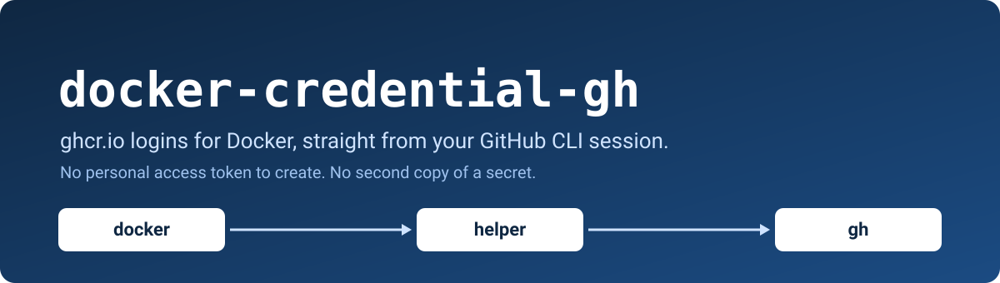
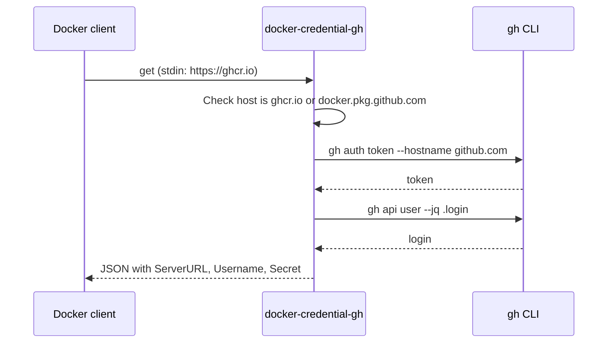

<p align="center">
  
</p>

<p align="center">
  <a href="https://www.npmjs.com/package/docker-credential-gh"></a>
  <a href="https://www.npmjs.com/package/docker-credential-gh"></a>
  <a href="LICENSE"></a>
  <a href="package.json">= 20" src="https://img.shields.io/badge/node-%3E%3D20-339933?logo=nodedotjs&logoColor=white"></a>
  
  
</p>

<p align="center">
  <a href="#why">Why</a> ·
  <a href="#what-it-does">What</a> ·
  <a href="#features">Features</a> ·
  <a href="#demo">Demo</a> ·
  <a href="#architecture">Architecture</a> ·
  <a href="#security-model">Security</a> ·
  <a href="#limitations">Limitations</a> ·
  <a href="#quick-start">Quick start</a> ·
  <a href="#configure-docker">Configure</a> ·
  <a href="#testing">Testing</a> ·
  <a href="#roadmap">Roadmap</a> ·
  <a href="#license">License</a>
</p>

# docker-credential-gh

A [Docker credential helper](https://github.com/docker/docker-credential-helpers) for `ghcr.io` (and `docker.pkg.github.com`) that reuses your existing [GitHub CLI](https://cli.github.com) session. No personal access token (PAT) to create, copy, or store.

## Why

Logging in to the GitHub Container Registry normally means creating a PAT and running `docker login ghcr.io`, so that Docker stores it. Piping `gh auth token` into `docker login` avoids the PAT, but it **copies** the token into Docker's credential store. That copy goes stale after `gh auth switch`, `gh auth logout` or `gh auth refresh`, and it is a second place where a secret lives.

A native solution has been requested for years: [cli/cli#5150](https://github.com/cli/cli/issues/5150) ("`gh` as Docker credential helper", still open at the time of writing).

Other tools in this space exist, for example [bradschwartz/docker-credential-ghcr-login](https://github.com/bradschwartz/docker-credential-ghcr-login) (Go) and [alexanderankin/docker-credential-helper-ghcr](https://github.com/alexanderankin/docker-credential-helper-ghcr). This project is a small alternative with a narrower goal: do nothing except forward what `gh` already knows, and never create or modify a token. It is not endorsed by GitHub, Docker or the GitHub CLI team.

## What it does

`docker-credential-gh` is an executable that speaks Docker's credential helper protocol. When Docker needs credentials for `ghcr.io`, the helper asks `gh` for the current token and login, and hands them back. Nothing is stored, so the registry login always follows your `gh` session.

## Features

Everything below is covered by the unit tests in [`test/protocol.test.ts`](test/protocol.test.ts), which run against a fake `gh`:

- `get` returns `{ServerURL, Username, Secret}` for `ghcr.io` and `docker.pkg.github.com` (bare host names and `https://` URLs, case-insensitive).
- Any other registry is refused with Docker's standard `credentials not found in native keychain` message, and `gh` is never called.
- Look-alike hosts (`evil-ghcr.io`, `ghcr.io.example.test`), non-`https` schemes, non-default ports and `user:pass@` URLs are refused.
- `store` and `erase` are silent no-ops; nothing is ever persisted.
- `list` advertises the supported registries using only the `gh` login (the token is not requested), and returns `{}` if `gh` is missing or logged out.
- Failure messages never contain `gh` output.
- Zero runtime dependencies: only Node's standard library is used.

## Demo

Real output from this repository (Node v22.14.0, Windows). Here `DOCKER_CREDENTIAL_GH_BIN` points to a non-existent executable, so no real `gh` session or token is involved:

```text
$ export DOCKER_CREDENTIAL_GH_BIN=gh-not-installed

$ docker-credential-gh version
docker-credential-gh 0.1.0
[exit 0]

$ docker-credential-gh list
{}
[exit 0]

$ echo https://index.docker.io/v1/ | docker-credential-gh get
credentials not found in native keychain
[exit 1]

$ echo https://ghcr.io | docker-credential-gh get
docker-credential-gh: the GitHub CLI (gh) was not found in PATH
[exit 1]
```

With a logged-in `gh`, the last command prints a JSON document containing your token, so it is deliberately not shown here.

## Architecture



Source layout:

| File | Role |
|---|---|
| `bin/docker-credential-gh.js` | Executable entry point. |
| `src/index.ts` | Reads stdin, dispatches the command, sets the exit code. |
| `src/protocol.ts` | The `get` / `store` / `erase` / `list` / `version` commands. |
| `src/registries.ts` | Strict server URL parsing and the supported-registry allowlist. |
| `src/gh.ts` | Runs `gh` (injectable executor, so tests never call the real one). |

## Security model

- The token lives only where `gh` keeps it (its keyring or its own config). This helper never writes it to disk, never caches it, and never logs it.
- The token is written to stdout only in response to `get`, for a supported registry, to the process that invoked the helper (Docker).
- Error messages never include `gh` output.
- Only `https` (or a bare host name) on the default port without embedded credentials is accepted, and hostnames are matched exactly after URL parsing.
- `gh` is run with an argument array (no shell) and a 15 s timeout.
- Anyone who can run commands as your user can already run `gh auth token`; this helper adds no new exposure. Treat it like `gh` itself.
- `DOCKER_CREDENTIAL_GH_BIN` overrides the `gh` executable path. It exists for unusual installs; do not point it at something you do not trust.

## Limitations

- **Never tested end to end** against a real Docker daemon/client or a real `gh` session. The tests use a fake `gh`; the protocol details were taken from the docker-credential-helpers sources, not from a live run.
- The Windows `.cmd` shim created by `npm link` has **not** been tested with Docker.
- Scopes are not verified. If your token lacks `read:packages` (pull) or `write:packages` (push), the registry will reject the request. Fine-grained tokens and GitHub App tokens are not expected to work with the container registry.
- Not a single binary: **Node.js >= 20 is required** at runtime.
- Only `github.com` registries; GitHub Enterprise Server is not supported.
- Tokens from `GH_TOKEN` / `GITHUB_TOKEN` are used as-is, because `gh auth token` honours them.
- Each `get` spawns `gh` twice, so expect a short delay per registry request.
- If `gh` ever ships native support for this (see the issue above), prefer that.

## Quick start

Requirements: Node.js >= 20 and [`gh`](https://cli.github.com) in `PATH`, logged in.

Install from npm. This puts the `docker-credential-gh` executable in your `PATH`, where Docker looks for it:

```sh
npm install -g docker-credential-gh
docker-credential-gh version
```

Or build from a clone:

```sh
git clone https://github.com/Emincanozen/docker-credential-gh.git
cd docker-credential-gh
npm install
npm test                                   # builds, then runs the tests
node bin/docker-credential-gh.js version   # prints: docker-credential-gh 0.1.0
```

Docker looks for an executable named `docker-credential-gh` in `PATH`. To make it available globally from the clone (this modifies your global npm prefix):

```sh
npm link
```

Then give `gh` the package scopes:

```sh
gh auth login --scopes read:packages,write:packages
# or, for an existing session:
gh auth refresh --scopes read:packages,write:packages
```

## Configure Docker

Edit `~/.docker/config.json` (Windows: `%USERPROFILE%\.docker\config.json`):

```json
{
  "credHelpers": {
    "ghcr.io": "gh",
    "docker.pkg.github.com": "gh"
  }
}
```

Docker then asks the helper instead of reading a stored login, so `docker login ghcr.io` is not needed. Whether a pull or push succeeds still depends on your token scopes and your access to the package.

Manual check (prints a secret, so do not paste the output anywhere):

```sh
echo ghcr.io | docker-credential-gh get
```

### Protocol behaviour

| Command | Behaviour |
|---|---|
| `get` | Reads a server URL on stdin; prints `{"ServerURL","Username","Secret"}` for supported registries. Unsupported registry: exit 1 and `credentials not found in native keychain` on **stdout**, where the Docker client matches it. Other failures (`gh` missing or logged out) also print their message on stdout, exit 1. |
| `store` | No-op, exit 0. |
| `erase` | No-op, exit 0. Use `gh auth logout` to revoke. |
| `list` | `{"https://ghcr.io": "<login>", "https://docker.pkg.github.com": "<login>"}`, or `{}` without a working `gh` session. |
| `version` | Prints the version. |

## Testing

```sh
npm test
```

Last run (Node v22.14.0, Windows): `tests 13, pass 13, fail 0`, about 0.3 s. Type checking is part of the build (`tsc`, strict mode). CI is defined in [`.github/workflows/ci.yml`](.github/workflows/ci.yml) (Ubuntu, Windows, macOS; Node 20 and 22); no CI result is recorded in this document.

## Roadmap

- End-to-end test against a real Docker client and `gh`, on Linux, macOS and Windows.
- A `configure-docker` command that edits `config.json` safely.
- Optional scope check with a helpful error message.
- GitHub Enterprise Server support.
- Possibly a single-file bundle to simplify installation.

## Contributing

Issues and pull requests are welcome: see [CONTRIBUTING.md](CONTRIBUTING.md). Security problems go through [SECURITY.md](SECURITY.md). Changes are listed in [CHANGELOG.md](CHANGELOG.md).

## License

MIT, see [LICENSE](LICENSE).
